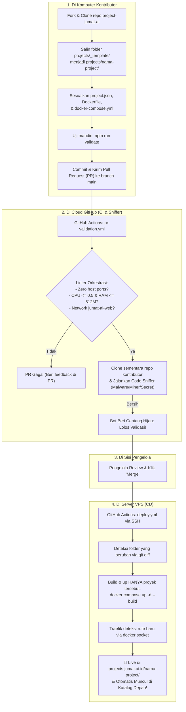

# Panduan Kontribusi Proyek Komunitas — Jumat.AI

Terima kasih atas ketertarikan Anda untuk membagikan karya Anda di **[projects.jumat.ai.id](https://projects.jumat.ai.id)**! Platform ini adalah wadah terbuka bagi seluruh pembelajar dan praktisi AI di Indonesia.

---

## 🗺️ Alur Kontribusi (Overview)



---

## 📋 Syarat & Ketentuan Proyek

Untuk menjaga **keamanan**, **stabilitas server bersama**, dan **keadilan resource**, setiap proyek yang diunggah wajib mematuhi aturan berikut:

1. **Format Aplikasi:** Harus diorkestrasikan menggunakan **Dockerfile** (multi-stage build yang meng-clone kode dari repo GitHub Anda) dan **docker-compose.yml**.
2. **Konektivitas & Routing:**
   - DILAYANI melalui subdomain utama: `https://projects.jumat.ai.id/<nama-project>`.
   - **Zero Host Port Exposure:** DILARANG menggunakan deklarasi `ports:`. Hanya gunakan `expose:` untuk port internal container.
   - Wajib terhubung ke network eksternal: `jumat-ai-web`.
3. **Batasan Resource:**
   - **CPU:** Maksimal `0.5` vCPU (`deploy.resources.limits.cpus: '0.5'`).
   - **RAM:** Maksimal `512 MB` (`deploy.resources.limits.memory: 512M`).
4. **Keamanan & Standar Kode:**
   - Dilarang menggunakan `privileged: true`.
   - Dilarang me-mount volume direktori sistem host (`/`, `/var`, `/etc`, atau `docker.sock`).
   - Repositori kode Anda akan dipindai oleh **Code Sniffer** otomatis saat Pull Request untuk memastikan bebas dari malware, script crypto-mining, reverse shell, dan kebocoran kredensial pribadi.

---

## 🚀 Langkah-Langkah Mengirimkan Proyek Baru

### 1. Fork & Clone Repositori
1. Klik tombol **Fork** di repositori GitHub `project-jumat-ai`.
2. Kloning ke komputer Anda:
   ```bash
   git clone https://github.com/<username-anda>/project-jumat-ai.git
   cd project-jumat-ai
   npm install
   ```

### 2. Salin Starter Template
Salin folder `projects/_template` menjadi nama proyek Anda (gunakan huruf kecil dan strip):
```bash
# Contoh nama slug: audio-summarizer
cp -r projects/_template projects/audio-summarizer
```

### 3. Sesuaikan Metadata `projects/<slug>/project.json`
Buka file `project.json` di dalam folder proyek Anda:
```json
{
  "slug": "audio-summarizer",
  "title": "Audio AI Summarizer",
  "description": "Ringkas file audio panjang menggunakan Whisper dan LLM.",
  "repo_url": "https://github.com/username_anda/audio-summarizer-app",
  "branch": "main",
  "internal_port": 8000,
  "author": {
    "name": "Nama Lengkap Anda",
    "github": "username_github_anda",
    "avatar": "https://github.com/username_github_anda.png"
  },
  "tags": ["audio", "whisper", "summarizer"],
  "ai_type": "external-backend",
  "resources": {
    "cpu": "0.5",
    "memory": "512M"
  },
  "version": "1.0.0",
  "created_at": "2026-11-20"
}
```

### 4. Sesuaikan `projects/<slug>/Dockerfile`
Pastikan argumen `REPO_URL` dan `BRANCH` mengarah ke repositori aplikasi Anda:
```dockerfile
FROM alpine/git:latest AS cloner
ARG REPO_URL="https://github.com/username_anda/audio-summarizer-app.git"
ARG BRANCH="main"
WORKDIR /source
RUN git clone --depth 1 --branch ${BRANCH} ${REPO_URL} . && rm -rf .git

# Ganti base image sesuai bahasa aplikasi Anda (Python / Node / dll)
FROM python:3.11-slim AS runner
WORKDIR /app
COPY --from=cloner /source /app
RUN if [ -f requirements.txt ]; then pip install --no-cache-dir -r requirements.txt; fi

EXPOSE 8000
CMD ["uvicorn", "main:app", "--host", "0.0.0.0", "--port", "8000"]
```

### 5. Sesuaikan `projects/<slug>/docker-compose.yml`
Ganti seluruh teks `nama-project-anda` dengan nama slug proyek Anda dan pastikan port internal sesuai:
```yaml
version: '3.8'

services:
  app:
    container_name: jumat-ai-audio-summarizer
    build:
      context: .
      args:
        REPO_URL: "https://github.com/username_anda/audio-summarizer-app.git"
        BRANCH: "main"
    restart: unless-stopped
    expose:
      - "8000"
    networks:
      - traefik-net
    deploy:
      resources:
        limits:
          cpus: '0.5'
          memory: 512M
    labels:
      - "traefik.enable=true"
      - "traefik.docker.network=jumat-ai-web"
      - "traefik.http.routers.audio-summarizer.rule=Host(`projects.jumat.ai.id`) && PathPrefix(`/audio-summarizer`)"
      - "traefik.http.routers.audio-summarizer.entrypoints=websecure"
      - "traefik.http.routers.audio-summarizer.tls=true"
      - "traefik.http.middlewares.audio-summarizer-strip.stripprefix.prefixes=/audio-summarizer"
      - "traefik.http.routers.audio-summarizer.middlewares=audio-summarizer-strip"
      - "traefik.http.services.audio-summarizer.loadbalancer.server.port=8000"

networks:
  traefik-net:
    name: jumat-ai-web
    external: true
```

### 6. Uji Validasi Mandiri
Jalankan skrip pengujian otomatis sebelum melakukan commit:
```bash
npm run validate
```
Pastikan seluruh indikator berstatus `✔ [PASS]`.

### 7. Kirim Pull Request (PR)
1. Commit dan push perubahan Anda ke GitHub:
   ```bash
   git add projects/audio-summarizer/
   git commit -m "feat: tambah proyek audio-summarizer"
   git push origin main
   ```
2. Buka GitHub repositori utama `project-jumat-ai` dan klik **Compare & pull request**.
3. Sistem CI otomatis akan memvalidasi file orkestrasi Anda dan menjalankan **Code Sniffer** pada repositori aplikasi Anda.
4. Setelah diverifikasi dan disetujui oleh pengelola, proyek Anda otomatis di-build dan langsung live di **`https://projects.jumat.ai.id/<nama-project>`**! 🎉
