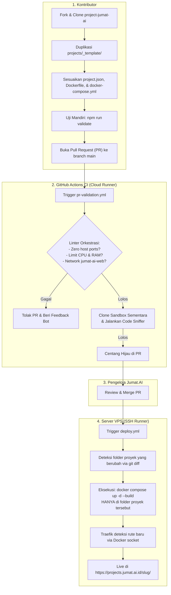

# 🏛️ Arsitektur Sistem — Project Jumat.AI

Dokumen ini menjelaskan rancangan arsitektur teknis, isolasi jaringan, tata kelola container, serta sistem keamanan otomatis platform **projects.jumat.ai.id**.

---

## 1. 🌐 Arsitektur Jaringan & Isolasi Traefik

Server produksi menjalankan **Traefik** sebagai reverse proxy utama untuk semua layanan (proyek pribadi dan proyek komunitas).

### Tantangan Keamanan Jaringan
Secara bawaan pada Docker, jika container proyek komunitas diletakkan di network `web` yang sama dengan proyek-proyek pribadi Anda, container komunitas dapat melakukan scanning dan menghubungi port internal proyek pribadi Anda via Docker DNS.

### Solusi: Isolasi Multi-Network Traefik
Traefik memiliki kemampuan untuk terhubung ke **lebih dari satu Docker network** sekaligus. Kita memanfaatkan fitur ini untuk memisahkan domain keamanan:

```text
                                  INTERNET
                                     │
                             (Port 80 / 443)
                                     ▼
                      ┌─────────────────────────────┐
                      │    Traefik Reverse Proxy    │
                      └──────────────┬──────────────┘
                                     │
           ┌─────────────────────────┴─────────────────────────┐
           │                                                   │
  (Network: "web")                                  (Network: "jumat-ai-web")
           ▼                                                   ▼
┌─────────────────────────┐                       ┌─────────────────────────┐
│  Proyek Pribadi Anda    │                       │ Proyek Komunitas AI 1   │
│  - database internal    │                       │  (RAM <= 512M, CPU 0.5) │
│  - api pribadi          │                       ├─────────────────────────┤
│  - web klien            │                       │ Proyek Komunitas AI 2   │
└─────────────────────────┘                       │  (RAM <= 512M, CPU 0.5) │
                                                  └─────────────────────────┘
                                                               │
                         [TERISOLASI TOTAL DARI NETWORK "web"] ◄─┘
```

### Konfigurasi 1-Kali di Server
Untuk mengaktifkan isolasi ini, jalankan perintah berikut sekali saja di server Anda:
```bash
# 1. Buat network terisolasi khusus proyek komunitas
docker network create jumat-ai-web

# 2. Hubungkan container Traefik yang sudah ada ke network baru ini
docker network connect jumat-ai-web <nama_container_traefik_anda>
```

Dengan langkah di atas:
1. Traefik dapat merutekan trafik HTTPS ke proyek komunitas di `projects.jumat.ai.id/<nama-project>`.
2. Proyek komunitas **tidak memiliki akses jaringan sama sekali** ke network `web` tempat proyek pribadi Anda berjalan.

---

## 2. 📦 Siklus Build Multi-Stage (Clean Server)

Source code aplikasi berada di repositori GitHub masing-masing kontributor. Repositori `project-jumat-ai` Anda hanya menyimpan orkestrasinya (`Dockerfile`, `docker-compose.yml`, dan `project.json`).

### Mengapa Multi-Stage Build?
```dockerfile
# Stage 1: Cloner
FROM alpine/git:latest AS cloner
ARG REPO_URL
RUN git clone --depth 1 ${REPO_URL} /source

# Stage 2: Runner
FROM node:20-alpine
COPY --from=cloner /source /app
...
```
* **Disk Server Ramping:** Git history, tool git, dan file sementara dibuang oleh Docker saat build selesai.
* **Isolasi Kode:** Server tidak menyimpan file mentah di direktori luar container. Seluruh dependensi terkapsul di dalam image container.

---

## 3. 🔄 Alur Lengkap GitOps (Dari PR Hingga Deploy)

Mekanisme penambahan dan pembaruan proyek diatur secara otomatis melalui siklus GitOps:



---

## 4. ⚡ Eksekusi Build Independen Per Proyek

Salah satu keunggulan utama arsitektur ini adalah **efisiensi deploy**:
* GitHub Action mendeteksi folder proyek mana yang mengalami perubahan:
  ```bash
  git diff --name-only HEAD~1 HEAD | grep '^projects/'
  ```
* Runner SSH hanya mengeksekusi build pada folder yang bersangkutan:
  ```bash
  cd /var/www/projects.jumat.ai.id/projects/<slug-yang-berubah>
  docker compose up -d --build --remove-orphans
  ```
* **Keuntungan:** Puluhan proyek lain yang sedang aktif berjalan tidak akan terganggu, tidak mengalami restart, dan server tidak terbebani me-rebuild proyek yang tidak berubah.

---

## 5. 🛡️ Penegakan Keamanan & Code Sniffer

Setiap Pull Request (PR) yang masuk melewati 2 lapis pengujian otomatis di GitHub Actions sebelum diizinkan untuk di-merge:

### Lapis 1: Linter Aturan Orkestrasi (`validate-pr.js`)
* 🚫 **Zero Host Port Exposure:** Dilarang menggunakan deklarasi `ports:`. Hanya `expose:` internal yang diizinkan agar seluruh trafik wajib melewati Traefik.
* 🚫 **No Privileged Mode:** Larangan keras untuk `privileged: true`.
* 🚫 **No Host Root Bind-Mount:** Dilarang me-mount direktori sistem host (`/`, `/var`, `/etc`, atau `/var/run/docker.sock`).
* ⚖️ **Resource Quota Enforced:** Wajib menyertakan batasan:
  - CPU: Maksimal `0.5` vCPU.
  - RAM: Maksimal `512M`.

### Lapis 2: Code Sniffer Sandbox di Cloud GitHub
Sebelum kode menyentuh server Anda, GitHub Actions meng-clone repositori kontributor ke sandbox runner sementara dan memindai:
1. **Pencegahan Kripto-Mining:** Memindai pola `xmrig`, `stratum+tcp`, `nanopool`, dll.
2. **Pencegahan Reverse Shell:** Memindai pola `nc -e`, `/dev/tcp/`, `mkfifo`, dll.
3. **Pencegahan Kebocoran Rahasia:** Memindai RSA Private Key, AWS Key, atau API Key yang tertinggal di repositori publik.

---

## 6. 🏷️ Traefik Routing & Middleware StripPrefix

Setiap proyek disajikan pada sub-path: `projects.jumat.ai.id/<slug>`.

Agar aplikasi kontributor tidak perlu mengubah kode routing internalnya, middleware `stripprefix` digunakan:
```yaml
labels:
  - "traefik.enable=true"
  - "traefik.docker.network=jumat-ai-web"
  - "traefik.http.routers.slug.rule=Host(`projects.jumat.ai.id`) && PathPrefix(`/slug`)"
  - "traefik.http.middlewares.slug-strip.stripprefix.prefixes=/slug"
  - "traefik.http.routers.slug.middlewares=slug-strip"
  - "traefik.http.services.slug.loadbalancer.server.port=3000"
```
Dengan konfigurasi ini:
* Pengguna mengakses: `https://projects.jumat.ai.id/voice-ai/api/generate`
* Aplikasi di container menerima request bersih: `/api/generate`

---

## 7. 📋 Technical Debt & Pengembangan Mendatang

Daftar pertimbangan arsitektur dan fitur yang ditangguhkan ke iterasi berikutnya (termasuk manajemen file kredensial mandiri kontributor ala *GitLab Secure Files*) dapat dilihat pada dokumen:
👉 **[docs/TECHNICAL_DEBT.md](file:///D:/AI/project-jumat-ai/docs/TECHNICAL_DEBT.md)**

